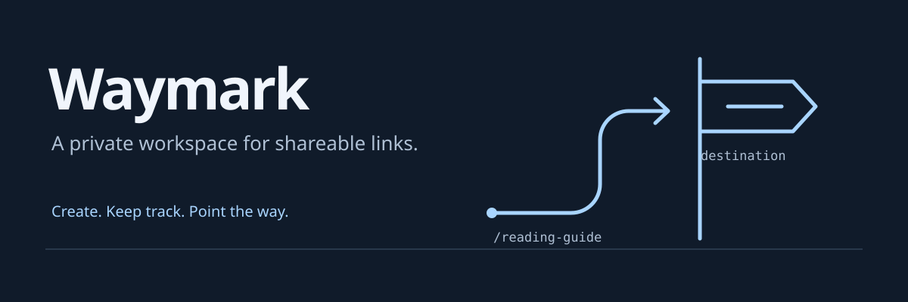

# Linko — URL shortener and telemetry exercise

> **Learning journey project · Boot.dev**
> Starter repository for the Logging and Telemetry course, with local coursework changes.

**Shorten URLs while exploring logging, metrics, and traces in a Go service.**

Linko is an intentionally small course starter. This checkout contains work in progress; its source and prerequisites may change as the exercises progress. Upstream origin: [bootdotdev/linko-starter](https://github.com/bootdotdev/linko-starter).

[Run locally](#-quick-start)

##  Features

- Explore URL shortening in a small Go service.
- Work through logging and telemetry exercises.
- Inspect local persistence and request-handling behavior.

##  Installation

Requires Go 1.27 or newer. From this checkout:

Run the commands below from the project checkout.

##  Quick start

```bash
go run .
```

The current entrypoint defaults to port 8899 and stores data under `./data`. Use `go run . -help` to inspect available flags. Ctrl+C requests shutdown.

##  Learning context

The course uses a small, deliberately imperfect service to explore logs, metrics, and traces. Local changes are coursework in progress, not a published release or production-readiness claim.
