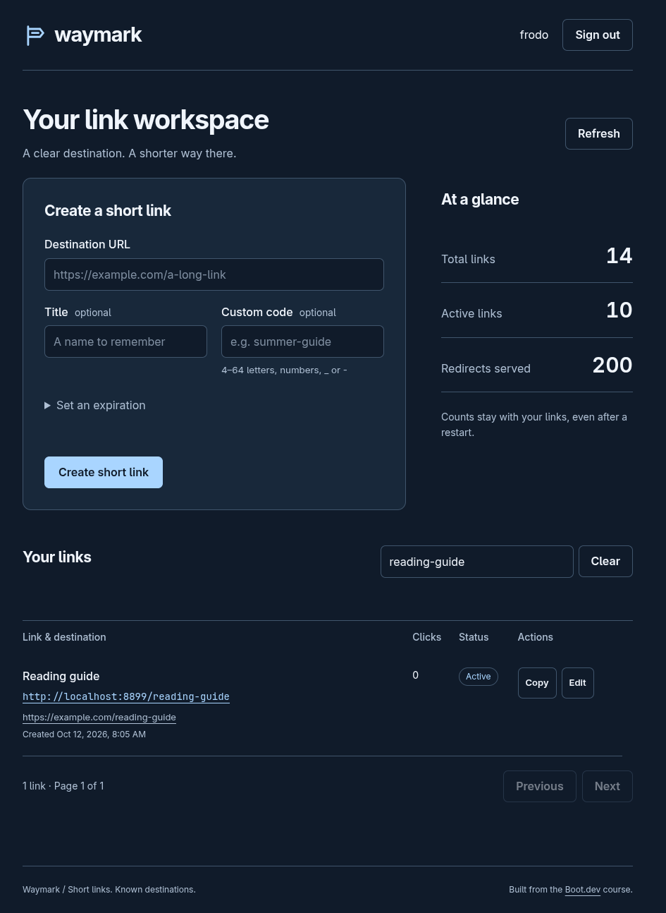
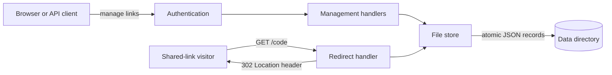

# Waymark — Private link workspace

Create short links you can name, update and keep track of.

Waymark gives one trusted account a browser workspace for managing public redirects. Add a destination, choose a memorable code, and share the short address. Titles, expiration dates and click totals stay with your links across restarts. The Go server embeds the interface and stores records on disk; external monitoring services are optional.

**[Run Waymark](#-quick-start)** · [API reference](docs/api.md) · [Observability walkthrough](docs/observability.md)

For developers and reviewers, the [observability walkthrough](docs/observability.md) follows the logging pipeline, metrics, traces, dashboard and profiling workflow through the actual source. The shortener is the user-facing product; request diagnosis is the engineering focus.

Designed for a modest private workspace with **one running process per data directory**. Production requires your own credentials and an HTTPS reverse proxy.



The browser workspace manages links; anyone with a shared short address can follow it without signing in. This preview uses example data.

##  Features

- **Make links recognizable.** Use a generated code or choose your own, add a title, and copy the shareable address.
- **Keep control of destinations.** Edit URLs, schedule expiration, or disable and re-enable a link. Revision checks reject stale edits.
- **Find what you shared.** Search titles, URLs and codes; browse 20 links per page and inspect persistent click totals.
- **Run a contained workspace.** Cookie sessions protect management routes; public redirects validate destinations without fetching them.
- **Inspect actual requests.** Structured logs, Prometheus counters and duration histograms, optional traces, and authenticated development profiles expose server behavior.

##  Installation

Requires **Go 1.27 or later**. Obtain the source, then work from its root—the directory containing `go.mod`. Docker Compose is needed only for the optional monitoring stack. Make provides convenience targets; direct Go commands also work.

```bash
git clone https://github.com/yaqyn/waymark-link-shortener.git
cd waymark-link-shortener
go mod download
```

There is no database service or migration to run. Waymark creates `./data` on startup. No public release binary or hosted demo is provided by this checkout.

##  Quick start

```bash
go run .
```

Open **http://localhost:8899**, then sign in with the development account `frodo` / `ofTheNineFingers`. These are public demo credentials for local use; production mode refuses to start without a configured password hash.

Enter `https://example.com/guide`, set the custom code to `reading-guide`, and click **Create short link**. Copy `http://localhost:8899/reading-guide`; opening it redirects to the destination. Press **Ctrl-C** in the server terminal to stop gracefully. Your link records remain in `data/`.

For a binary with Git SHA and UTC build time included in logs:

```bash
make build
./waymark -port 8899 -data ./data
```

##  Usage

The workspace supports creation, copying, search, pagination and editing. Choose **Edit** to update a destination or title, change its expiration, or disable it. A disabled or expired link returns **410 Gone**. Disabling retains the record and can be reversed; no permanent-delete endpoint exists.

Custom codes contain 4–64 ASCII letters, digits, underscores or hyphens; service paths are reserved. Generated codes have 10 characters. GET redirects increment click totals; HEAD requests do not. Counts represent served redirects, not unique visitors or proof that the destination loaded.

API clients can use Basic Auth, with HTTPS outside local development:

```bash
curl -u frodo:ofTheNineFingers \
  -H 'Content-Type: application/json' \
  --data '{"url":"https://example.com/guide","code":"api-guide","title":"Reading guide"}' \
  http://localhost:8899/api/shorten

curl -I http://localhost:8899/api-guide
```

Creation returns **201 Created** and a JSON record containing `short_code`, `long_url`, timestamps, state, click count and revision. The second command returns **302 Found** with a `Location` header. Reusing a code returns **409 Conflict**.

See the [API reference](docs/api.md) for routes, request bodies, pagination, revision checks and error responses.

##  Configuration

The app reads `WAYMARK_USERNAME`, `WAYMARK_PASSWORD_HASH_FILE`, `WAYMARK_BIND_ADDR` and `WAYMARK_LOG_FILE`. By default it binds to loopback and uses the development account. `ENV=production` requires configured credentials, sets secure cookies, authenticates metrics, hides development profiling and shutdown routes, and writes JSON to stderr.

[Configure credentials and runtime settings](docs/configuration.md). `.env.example` is a reference; the app does not load `.env` automatically.

Coming from Linko? Read the [migration guide](docs/migration.md) before changing a deployment. Stored links keep their format and shortcode paths; environment names, the binary, session cookie and telemetry scope have changed.

##  Architecture

One Go process serves the embedded interface, authenticated management API and public redirects. Middleware supplies request IDs, response logs, metrics and optional root spans. The store serializes concurrent access and publishes records atomically.



The visitor's browser follows the destination. Waymark does not fetch it, so creating a link cannot turn the server into a destination-checking proxy.

[Read the architecture and repository map](docs/architecture.md). [PRODUCT.md](PRODUCT.md) records the access model; [DESIGN.md](DESIGN.md) and [UX-CONTRACT.md](UX-CONTRACT.md) record the visual and interaction contracts.

##  Verification

```bash
go test -race ./...
go vet ./...
```

Tests exercise authenticated creation and redirects, persistence, concurrent visits, expiration, stale edits, legacy files, CSRF rejection, body limits, reserved paths, bounded metric labels, safe error responses and startup failures. Race checks cover in-process concurrency; they do not establish safety for multiple processes sharing storage.

GitHub Actions runs race tests, Go vet, a binary build and a container build on pushes and pull requests. See [Verify](https://github.com/yaqyn/waymark-link-shortener/actions/workflows/verify.yaml).

The [observability walkthrough](docs/observability.md) explains structured errors, redaction, request/trace correlation, route-based metrics and the reproducible Grafana dashboard. The [operations guide](docs/operations.md) covers Docker, telemetry, backup, profiling and failure checks. Historical course profile files remain local artifacts, not benchmarks of the current app.

##  Security and limitations

- **One trusted account.** Every authenticated client manages every link. No registration, separate tenants, roles or public abuse-reporting workflow.
- **One writer per data directory.** Directory scans and synced per-click writes suit modest usage. Use a transactional database before adding replicas or high-volume analytics.
- **HTTPS for production.** Configure your own password hash, preserve the original Host header through the proxy, restrict backend ingress and keep telemetry private. Secure cookies require HTTPS.
- **Redirect destinations remain your responsibility.** Only HTTP/HTTPS URLs without embedded credentials are accepted. Syntax validation does not establish that a site is safe, reachable or trustworthy.
- **Logs need care.** Sensitive keys, URL passwords and IPv4 final octets are redacted. Arbitrary paths and query strings can still contain secrets; do not include them in shared URLs or logs.

See [operations and recovery](docs/operations.md) for backups, service limits, session behavior and troubleshooting.

##  Contributing

Maintained by **Abdulrahman M. Yaqyn**. [Report a reproducible issue](https://github.com/yaqyn/waymark-link-shortener/issues). Start with the [contribution guide](CONTRIBUTING.md), explain the behavior you want to change, and include the checks that support it. Keep the private access model and data compatibility intact unless a change explicitly revises those contracts.

##  License

[MIT](LICENSE). The original Boot.dev copyright notice is retained. Waymark's extensions and documentation are maintained by Abdulrahman M. Yaqyn.

> **Learning Journey Project · Boot.dev.** Originated in [bootdotdev/linko-starter](https://github.com/bootdotdev/linko-starter) and the Logging and Telemetry course; extended into a private link workspace with sessions, editable records, persistent counters and optional observability.
